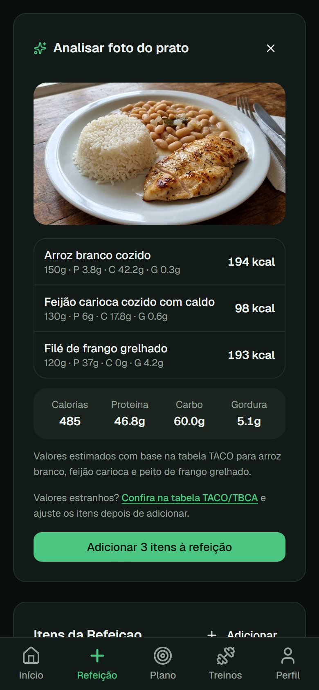
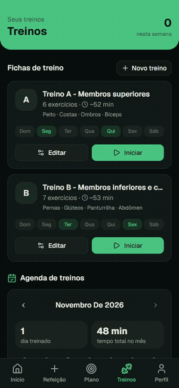
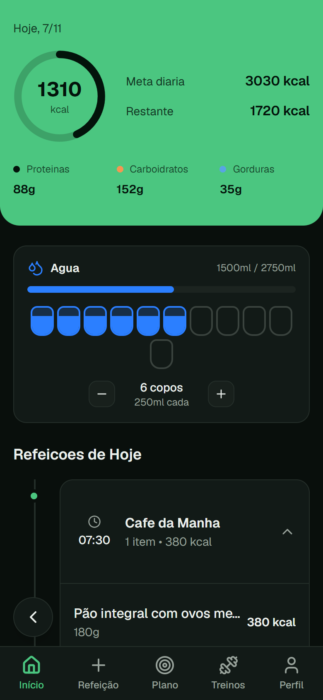
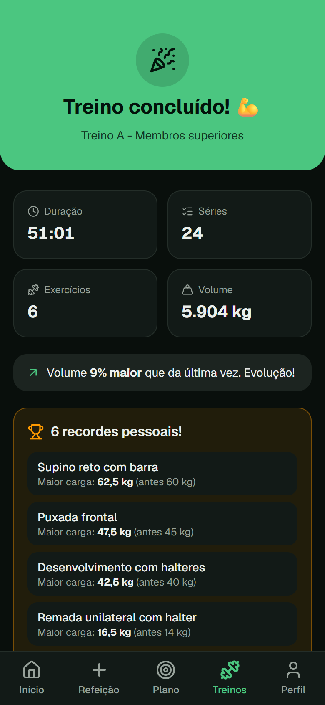
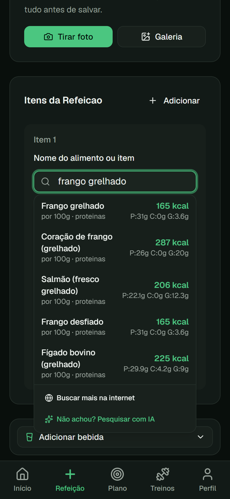
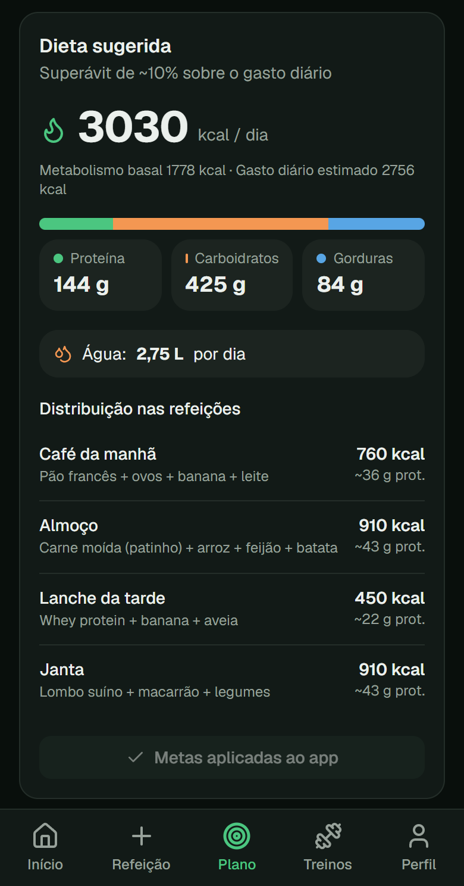
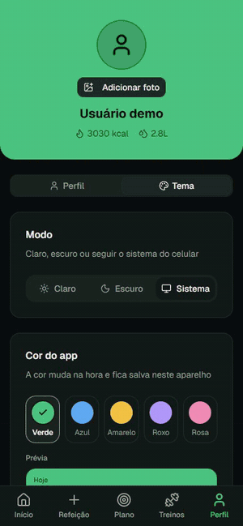
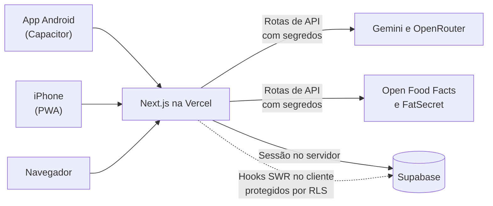

# 🌿 MyDiet

**Controle de dieta e treinos em um só app, com análise de refeições por foto usando IA.**

Web app mobile-first em português, instalável como aplicativo no Android e no iPhone, feito para uso próprio e de amigos e testado em celulares reais.

[](https://nextjs.org)
[](https://react.dev)
[](https://www.typescriptlang.org)
[](https://supabase.com)
[](https://tailwindcss.com)
[](https://capacitorjs.com)

**[🔗 Acessar o app](https://controle-dieta.vercel.app)**

<table>
  <tr>
    <td align="center"><br><b>Refeição analisada por foto</b></td>
    <td align="center"><br><b>Treino com recordes em tempo real</b></td>
    <td align="center"><br><b>Painel do dia</b></td>
    <td align="center"><br><b>Resumo e evolução</b></td>
  </tr>
  <tr>
    <td align="center"><br><b>Busca de alimentos</b></td>
    <td align="center"><br><b>Plano calculado</b></td>
    <td align="center"><br><b>Temas personalizáveis</b></td>
  </tr>
</table>

<sub>Imagens de uma conta de demonstração, com dados de exemplo.</sub>

---

## Sobre o projeto

Criei o MyDiet para resolver um problema meu: acompanhar alimentação e academia sem depender de vários apps diferentes. O projeto cobre o ciclo completo de um produto: da modelagem do banco e da integração com IA até a publicação e os testes em celulares reais.

## Funcionalidades

### 🍽️ Dieta
- **Análise de refeição por foto:** a IA estima porção, calorias e macronutrientes
- **Busca de alimentos** com autocomplete, combinando Open Food Facts, FatSecret e IA
- Valores priorizando as tabelas brasileiras **TACO** e **TBCA**
- Painel diário com calorias, macros, hidratação e histórico por dia

### 🏋️ Treinos
- Criação de treinos com dias da semana, capa, cargas por série e vídeos de execução
- **Modo de execução** com cronômetro de descanso e troca de exercício durante o treino
- Registro por tipo de exercício: carga, peso corporal, tempo e cardio
- **Detecção de recordes** de carga, repetições, tempo e 1RM estimado
- Resumo final com volume total, comparação com o treino anterior e calendário de histórico

### 🎯 Plano e personalização
- Plano nutricional e de treino calculado a partir dos dados corporais, com um ou mais objetivos
- Metas de peso com gráfico de evolução
- Modo claro e escuro, com 5 cores de tema

## Stack

| Camada | Tecnologias |
|---|---|
| **Front-end** | Next.js 16 (App Router), React 19, TypeScript, Tailwind CSS 4, shadcn/ui, Recharts |
| **Dados** | SWR, Zod, React Hook Form, Fuse.js |
| **Back-end** | Route Handlers, Server Actions, Supabase (Auth, Postgres, Storage) |
| **IA** | Google Gemini, com fallback para modelos via OpenRouter |
| **Mobile** | Capacitor 8 (Android) e PWA (iPhone) |
| **Infra** | Vercel, com deploy contínuo a partir da `main` |

## Arquitetura



As páginas falam direto com o Supabase por meio de hooks SWR, e a segurança dos dados fica no **Row Level Security** do Postgres. As rotas de API existem só para o que depende de segredos do servidor, como IA e fontes externas de alimentos.

## Desafios técnicos

**IA resiliente com serviços gratuitos.** Provedores gratuitos falham, atrasam e têm cota diária. Por isso, a análise percorre uma lista de tentativas, com timeout por modelo e um orçamento total abaixo do limite da função serverless. O OpenRouter fica por último porque até as falhas contam no limite diário. As respostas passam por validação com Zod, já que alguns modelos devolvem números como texto.

**Dados de alimentos confiáveis.** Cada fonte usa um formato diferente e bases abertas têm erros. Todos os alimentos são normalizados para 100 g ou 100 ml e descartados quando as calorias informadas não batem com os macronutrientes.

**Autenticação em três camadas.** O middleware valida o JWT localmente, sem ida à rede a cada requisição, e renova a sessão. O layout valida de novo no servidor, e o RLS protege os dados no banco.

**Um site, três formas de uso.** Publicar sem lojas exigiu tratar diferenças de cada plataforma: o app Android carrega o site em uma WebView nativa com Capacitor, então cada deploy atualiza o app sem novo APK. Na prática, isso incluiu corrigir conteúdo atrás da barra de status com as áreas seguras do sistema, o botão voltar do Android e um manifest que respondia localmente, mas dava 404 em produção.

**Treino sem risco de perder dados.** O progresso fica salvo no aparelho a cada série e só é enviado ao banco ao concluir, então fechar o app no meio do treino não apaga o que foi registrado.

**Datas no fuso local.** `toISOString()` usa UTC e, no Brasil, retorna o dia seguinte depois das 21h. Um módulo próprio garante que as refeições fiquem no dia certo.

## Como rodar

Pré-requisitos: Node.js 22+, pnpm e um projeto no Supabase.

```bash
git clone https://github.com/RaylanGabriel/mydiet.git
cd mydiet
pnpm install
```

Crie um arquivo `.env.local` na raiz:

```env
NEXT_PUBLIC_SUPABASE_URL=
NEXT_PUBLIC_SUPABASE_ANON_KEY=
SUPABASE_SERVICE_ROLE_KEY=
GEMINI_API_KEY=
OPENROUTER_API_KEY=
FATSECRET_CLIENT_ID=
FATSECRET_CLIENT_SECRET=
```

Execute os arquivos de `scripts/` em ordem no SQL Editor do Supabase e inicie com `pnpm dev`. Os scripts ainda não cobrem todas as tabelas: as de treinos, água e alimentos comuns não têm `CREATE TABLE` versionado.

## Estrutura

```text
app/          Rotas, páginas e rotas de API
components/   Componentes da interface, de treinos e do plano
hooks/        Leitura e escrita de dados com SWR
lib/          Regras de negócio, cálculos e integrações
scripts/      Migrações SQL numeradas
android/      Projeto nativo do Capacitor
```

## Próximos passos

- [ ] Testes automatizados nas regras de negócio
- [ ] Recuperação de senha por e-mail
- [ ] Script completo para recriar o banco do zero
- [ ] Modo offline para os treinos

## Autor

Feito por **Raylan Miranda** · [LinkedIn](https://www.linkedin.com/in/raylan-miranda/) · [GitHub](https://github.com/RaylanGabriel)

Desenvolvido com apoio de ferramentas de IA, como v0 e Claude Code.
